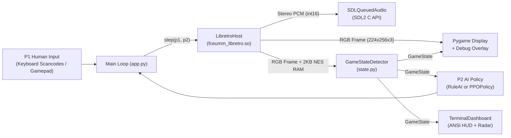

# Architecture & State Detection

This document describes the internal architecture of **Contra AI Co-Player**, including the Libretro host wrapper, V4 game state detection (NES RAM + frame heuristics), audio/video pacing, and input pipeline.

## High-Level Data Flow

## Module Breakdown

| Module | Responsibility |
| --- | --- |
| `src/contra_coplayer/libretro.py` | Synchronous `ctypes` wrapper around a Libretro `.so` core (`LibretroHost`). Handles environment/video/audio/input callbacks, packed pixel decoding (`0RGB1555`, `RGB565`, `XRGB8888`), 2KB NES System RAM reads (`read_ram`), and binary save states (`save_state`, `load_state`). |
| `src/contra_coplayer/state.py` | `GameStateDetector` and `analyze_obstacles`. Extracts structured `GameState` from NES RAM and performs lightweight luminance/edge heuristics on the RGB frame around P2. |
| `src/contra_coplayer/app.py` | Real-time frontend (`run`, `main`), `SDLQueuedAudio`, `RuleAI`, layout-independent keyboard/gamepad input (`human_input`), and `draw_debug_overlay`. |
| `src/contra_coplayer/dashboard.py` | `TerminalDashboard`: throttled, zero-dependency ANSI terminal UI displaying runtime stats, P1/P2 telemetry, co-op spacing status, entity/threat counts, obstacle cues, and a 40×7 ASCII mini-radar. |
| `src/contra_coplayer/env.py` | Gymnasium environment (`ContraCoPlayerEnv`), 38-dim observation encoder (`encode_observation`), shaped co-op reward (`compute_reward`), `ScriptedP1Partner`, and Stage 1 2P save-state bootstrapper. |
| `src/contra_coplayer/policy.py` | `PPOPolicy`: loads a Stable-Baselines3 PPO `.zip` model and maps `GameState` to Libretro joypad button sets with automatic B-button pulsing for continuous rifle fire. |
| `src/contra_coplayer/train.py` | PPO training pipeline (`train_ppo`) supporting `DummyVecEnv` (single env) and `SubprocVecEnv` (parallel envs), periodic checkpoints, model resume, and JSON training summaries. |
| `src/contra_coplayer/eval_model.py` | Headless evaluation CLI (`evaluate_policy`) to benchmark a PPO model or the `RuleAI` baseline across multiple episodes. |

## Libretro Host (`libretro.py`)

`LibretroHost` binds the Libretro C API directly without external frontend wrappers:

- **Pixel formats supported**: `PIXEL_0RGB1555` (0), `PIXEL_XRGB8888` (1), and `PIXEL_RGB565` (2). `decode_frame()` decodes little-endian packed buffers with arbitrary row pitch into contiguous `(H, W, 3)` `uint8` RGB NumPy arrays.
- **Audio callbacks**: Supports both single-sample (`retro_set_audio_sample`) and batch (`retro_set_audio_sample_batch`) callbacks, copying stereo `int16` frames per `step()`.
- **Memory access**: `read_ram(MEMORY_SYSTEM_RAM)` reads the 2,048-byte (`0x0800`) NES System RAM snapshot via `retro_get_memory_data` / `retro_get_memory_size`.
- **Save states**: `save_state()` / `load_state()` wrap `retro_serialize_size`, `retro_serialize`, and `retro_unserialize` for instant episode resets during RL training and evaluation.

## V4 Game State Detection (`state.py`)

### Direct NES System RAM Map (`Contra (U)`)

`GameStateDetector.detect(frame, ram, frame_idx)` reads the following addresses from the 2KB NES System RAM:

| Address | Size | Field | Notes |
| --- | --- | --- | --- |
| `0x0022` | 1B | Two-player mode flag | `1` = 2-Player mode (also inferred from `0x33` / `0x91`) |
| `0x002C` | 1B | Game phase ID | `0`=TITLE, `1`=DEMO, `2`=STAGE_INTRO, `3`=STARTING, `4`=PLAYING, `5`=STAGE_CLEAR, `6`=GAME_OVER, `0xFF`=BOOT |
| `0x0030` | 1B | Stage index (0-based) | `0..7` → Stages 1–8 (`Jungle`, `Base 1`, `Waterfall`, `Base 2`, `Snow Field`, `Energy Zone`, `Hangar`, `Alien's Lair`) |
| `0x0032` | 1B | P1 lives | `0xFF` treated as `0` |
| `0x0033` | 1B | P2 lives | `0xFF` treated as `0` |
| `0x0064`–`0x0065` | 2B | Horizontal scroll X | Big-endian `(ram[0x64] << 8) \| ram[0x65]` when `phase_id >= 2` |
| `0x0090` / `0x0091` | 1B each | P1 / P2 active state | `> 0` while alive/active during `PLAYING` |
| `0x00AA` / `0x00AB` | 1B each | P1 / P2 weapon ID | Lower nibble: `0`=Rifle, `1`=Machine Gun, `2`=Fireball, `3`=Laser, `4`=Spread; bit `0x10` = Rapid (`+R`) |
| `0x0334` / `0x031A` | 1B each | P1 screen X / Y | Pixel coordinates in 256×240 screen space |
| `0x0335` / `0x031B` | 1B each | P2 screen X / Y | Pixel coordinates in 256×240 screen space |
| `0x07E2`–`0x07E3` | 2B | P1 score (÷100) | Little-endian; multiplied by `100` (`0xFFFF` treated as `0`) |
| `0x07E4`–`0x07E5` | 2B | P2 score (÷100) | Little-endian; multiplied by `100` (`0xFFFF` treated as `0`) |
| `0x04B8 + slot` | 16B | Enemy/projectile type | `slot` in `0..15`; `0` = inactive. Types `{0x05, 0x06, 0x16, 0x1B, 0x22, 0x27}` are classified as `enemy_bullet`, others as `enemy`. |
| `0x033E + slot` | 16B | Enemy/projectile X | Screen X coordinate for slot `0..15` |
| `0x0324 + slot` | 16B | Enemy/projectile Y | Screen Y coordinate (`0` or `>= 240` ignored) |
| `0x0388 + slot` | 16B | Player bullet type | `slot` `0..7` = `p1_bullet`, `8..15` = `p2_bullet`; `0` = inactive |
| `0x03C8 + slot` | 16B | Player bullet X | Screen X coordinate |
| `0x03B8 + slot` | 16B | Player bullet Y | Screen Y coordinate (`0` or `>= 240` ignored) |

Derived metrics computed per frame:

- `p1_p2_dx`, `p1_p2_dy`, `p1_p2_distance`: Vector and Euclidean distance from P1 to P2.
- `nearest_enemy_dist`: Minimum distance from P2 to any active enemy.
- `nearest_threat_dist`: Minimum distance from P2 to any active enemy or enemy bullet.

### RGB Frame Obstacle Analysis (`analyze_obstacles`)

Because NES tilemap collision data varies across stages, `analyze_obstacles(frame, x, y)` supplements RAM data with fast vectorized luminance/gradient checks around P2's `(x, y)` position:

1. **Ground / Pit ahead** (`x+6..x+26`, `y+14..y+32`):
   - Computes mean vertical luminance gradient per row (`v_edges`) and brightness ratio (`> 35.0`).
   - `ground_ahead = True` when `max_energy > 14.0` and `bright_ratio > 0.20` (recording `ground_y`).
   - Otherwise, `pit_ahead = True` when `y < height - 36` and the patch is dark or uniform (`bright_ratio < 0.18` or `max_energy < 8.0`).
2. **Wall ahead** (`x+10..x+24`, `y-8..y+10`):
   - `wall_ahead = True` when mean horizontal gradient `> 22.0` and bright pixel ratio (`> 40.0`) `> 0.35`.
3. **Platform above** (`x-8..x+16`, `y-48..y-16`):
   - `platform_above = True` when max vertical gradient `> 45.0` and bright pixel ratio (`> 35.0`) `> 0.15`.

## RuleAI Baseline (`app.py`)

When no `--model` is provided, Player 2 uses `RuleAI`:

- Holds `B` (shoot) and `RIGHT` (advance) by default.
- Performs periodic jumps (`jump_period=85`, `jump_length=13` frames).
- When `GameState` is available and P2 is active:
  - Jumps if `obstacles_p2.pit_ahead` or `obstacles_p2.wall_ahead` is detected.
  - Jumps to dodge incoming enemy bullets within `-12 <= dx <= 36` and `|dy| <= 18` px.
  - Releases `RIGHT` if P2 gets more than `70` px ahead of P1 (`p1_p2_dx > 70`).

## Input, Audio & Frame Pacing (`app.py`)

- **Layout-independent keyboard input**: Tracks `KEYDOWN` / `KEYUP` physical USB HID scancodes (`SCANCODE_P1`) in addition to `pygame.key.get_pressed()` (`KEYBOARD_P1`), ensuring `Z`/`X`/`J`/`K` work even when the OS keyboard is switched to a non-Latin layout. Held scancodes are cleared on `WINDOWFOCUSLOST`.
- **Gamepad hot-plug**: Listens for `JOYDEVICEADDED` and `JOYDEVICEREMOVED` events; reads buttons `{0: B, 1: A, 6: SELECT, 7: START}`, left stick axes (deadzone `0.45`), and D-pad hat 0.
- **SDL2 Queued Audio (`SDLQueuedAudio`)**: Opens the default SDL2 audio device in signed 16-bit little-endian stereo (`0x8010`). If queued audio exceeds ~0.25 seconds (`rate * 4 // 4` bytes), the queue is cleared to prevent audio drift/latency buildup.
- **Frame scheduler**: Paces execution to `1.0 / core.av.timing.fps` using `time.perf_counter()` and `time.sleep()`, resetting the clock anchor if lag exceeds `250 ms`.
